# 🦴 NovaBone Dynamics

**뼈 체인 물리 시뮬레이션 애드온** — 머리카락, 꼬리, 스커트, 액세서리, 지글본을
클릭 몇 번으로 자동 물리 애니메이션으로 만들어 줍니다.

**제작자: Chamiseul**

[🇺🇸 English](./index.md)

---

## 🆕 v1.3.0 릴리즈 노트

v1.2.0 이후 바뀐 것을 전부 여기에 적었습니다. 수치는 테스트 리그(구 위에 놓인
체인, 뿌리 근처에 닿는 체인, root 본에 키를 준 같은 체인)에서 캐시를 비운 상태로
측정한 값입니다.

### Fix Bones: 마스터 본도 방향을 맞추고, 진짜 애니메이션만 본을 막습니다

- **자식이 머리 위에 있는 본은 이제 그 자식 방향으로 돌립니다.** 언리얼 리그는
  짧은 마스터 본(`MSTR_hair_back_r`)과 첫 번째 링크를 같은 관절 위치에 둡니다.
  메울 간격도, 향할 방향도 없어서 이런 본은 그대로 두었고, 익스포터가 정한
  방향을 그대로 보고 있었습니다. 이제 자식 본 자신의 축, 즉 체인이 실제로 놓인
  선을 따라갑니다. 길이는 바뀌지 않고, 스킨된 메시가 움직이지 않았는지는 Fix
  Bones가 그대로 확인합니다.
- **본 자신의 포즈 채널(위치·회전·스케일)에 키가 있을 때만 본을 막습니다.**
  커스텀 프로퍼티나 컨스트레인트 영향도에 키가 있어도 본 방향을 바꿔서 메시가
  움직이지는 않는데, 전에는 그 본 전체를 애니메이션 있는 본으로 취급했습니다.
- **Check가 키 때문에 건드리지 않은 본의 이름을 보여 줍니다.** 전에는 개수만
  나왔습니다.

### 캐릭터 안에 묻힌 머리카락 뿌리가 체인을 흔들어 놓지 않습니다

캐릭터에서는 충돌 대상이 보통 몸 메시 자체이고, 머리카락 뿌리는 두피 **안쪽**에,
귀걸이 고리는 귓불 안쪽에 있습니다. 체인의 그 부분은 애니메이션이 그렇게
놓은 것인데, 솔버가 이걸 충돌로 보고 움직일 수 없는 뿌리를 축으로 밖으로 밀어내서
체인 전체가 흔들렸습니다.

이제 **애니메이션 포즈**가 이미 충돌체 속에 묻어 둔 부분은 — 체인의 뿌리에서
끊기지 않고 이어진 구간만 — 건드리지 않습니다. 체인 중간의 본을 애니메이션이
충돌체 속으로 지나가게 하는 경우는 그대로 충돌로 처리합니다. 닫힌 부피가 아닌
메시(평면, 천)는 안쪽이 없으므로 묻힌 것으로 취급하지 않습니다.

체인 뿌리가 구 안쪽 0.14 m에 있는 장면에서 측정(끝 본이 애니메이션 위치에서
벗어난 거리, 전 → 후): 뿌리 정지 **0.395 → 0.087 m**, 뿌리가 움직일 때 **0.570 →
0.147 m**, 부드러운 체인 **0.589 → 0.186 m**, 뿌리가 움직일 때 가장 꺾인 관절
89° → 28°. 더 깊이 묻힌 체인(절반이 안쪽)은 전처럼 애니메이션 그대로입니다
(0.040 → 0.047 m).

> 💡 캐릭터 전체를 대상으로 해도 여전히 심하게 흔들리면 문제 해결의
> "캐릭터를 충돌 대상으로 쓸 때"를 보세요.

### 첫 번째 본이 고정된 머리를 축으로 크게 꺾이지 않습니다

체인의 첫 번째 본은 애니메이션된 부모에 매달려 있어서 머리가 움직이지 않습니다.
충돌체가 그 머리에 Radius보다 가까이 있으면, 접촉할 때마다 움직이지 않는 피벗을
축으로 본을 **전체** Radius만큼 밀어냈고, 그게 root 바로 아래의 "ぐきぃ" 꺾임이었습니다.
이제 본이 지켜야 하는 거리를 "머리의 실제 거리 → 끝에서 전체 Radius"로 서서히
키워서, 본이 필요한 만큼만 기웁니다.

12가지 설정(Radius 3종 × Stiffness 2종 × 정지/움직이는 root)에 충돌체 위치 4곳씩
측정: 첫 번째 본이 애니메이션 방향에서 벗어난 각도 **57° → 16°**, 가장 꺾인
관절 **58° → 16°**, 튐 **0.065 → 0.011**, 채터 0.0225 → 0.0161, 관통은 전후 모두
0. 더 나빠진 설정은 없습니다. Probe 모드에서만 적용되고 **Precise**는 전체
반경 그대로 정확히 접촉합니다.

### Influence가 1 미만이어도 충돌체를 뚫지 않습니다

Influence는 시뮬레이션 포즈와 원본 애니메이션을 섞는데, 원본은 충돌체를 모르기
때문에 섞인 포즈가 충돌체 안으로 들어갈 수 있었습니다. 이제 섞인 포즈를 다시
밖으로 밀어내고 아래 본들이 따라가서 체인이 끊기지 않습니다. 구를 뚫는 체인의
관통: Influence 0.5 **0.062 → 0**, Influence 0.3 **0.098 → 0**.

### 새 기능: Tip Radius

*Bone Collision Shape → Tip Radius.* **마지막** 본의 충돌 반경을 Radius에 대한
비율로 정합니다. 그 사이의 본은 직선으로 줄어듭니다. 1(기본값)이면 처음부터
끝까지 같은 반경입니다. *Show Bone Shapes*로 그려지는 본 모양도 같이 줄어듭니다.

### 새 기능: Keep Animated Clearance

*Bone Collision Shape → Keep Animated Clearance* (기본 OFF). 애니메이션 포즈가
이미 Radius보다 충돌체에 가까운 곳 — 머리카락이 두피에 붙은 자세 — 에서는 전체
Radius까지 밀어내지 않고 그 간격만 유지합니다. 허용 간격은 줄어들 땐 즉시, 다시
늘어날 땐 프레임당 40%씩 회복되고 Radius의 30% 아래로는 내려가지 않아서 표면
속으로 가라앉지 않습니다. 측정: 애니메이션 포즈에서 끝 본이 벗어난 거리
**0.054 → 0.042** (−23%), 튐 **0.027 → 0.017** (−35%), 관통 0.

### Chain 모드에서 Stiffness가 이제 동작합니다

Chain 모드에서 Stiffness가 당기는 힘을 계산만 하고 버리고 있어서
**Stiffness가 아무 효과가 없었습니다** — 0, 0.3, 0.6이 완전히 같은
움직임이었습니다. Head Stiffness(Floating Head)도 같은 버그로 머리를
원위치로 당기지 못했습니다. 둘 다 이제 동작합니다.

> ⚠️ **기존 씬이 더 뻣뻣해 보입니다.** 지금까지의 Chain 모드 씬과
> 프리셋은 전부 Stiffness가 없는 상태로 맞춰진 것입니다. 체인이 너무
> 서 있으면 Stiffness를 낮추세요: **0.05~0.1** 정도면 늘어지고, 0.5면
> 이미 중력을 버티고 거의 곧게 섭니다.

### 얇은 체인이 충돌체 속으로 가라앉지 않습니다

충돌체 안으로 자기 반지름보다 깊이 들어간 프로브는 감지되지 않아서,
한 번 그만큼 들어가면 계속 가라앉았습니다. 이제 표면 뒤쪽의 점도 감지합니다
(면의 뒤쪽으로 빠져나가는 레이로 확인하므로, 날카로운 모서리 바깥의 점을
안쪽으로 착각하지 않습니다).

Radius 0.01일 때 관통 깊이: 구 위의 체인 **0.028 → 0.006** (최대 0.073 →
0.018), root가 움직이는 같은 체인 **0.089 → 0.0003**, 수잔 **0.196 → 0.008**,
큐브 0.011 → 0.0004. 보통 Radius에서는 그대로입니다.

### 본의 뿌리 쪽에 닿아도 꺾이지 않습니다

충돌체가 본의 **머리(head) 쪽**에 닿으면 끝(tail)만 밀었습니다. 그러면
부모는 그대로인 채 본이 자기 머리를 축으로 크게 돌아서, 닿은 관절 바로
아래에서 체인이 꺾였습니다. 이제 밀어내는 양을 나눕니다: 접촉점이 본의
어디쯤인지에 따라 끝이 그만큼, 나머지는 **부모의 끝**(= 이 본의 머리)이
받습니다.

7개 장면(충돌체 위치 5가지씩) 측정: 튐은 6개에서 줄고 1개는 같습니다 —
root가 움직이고 Radius 0.01인 체인 **0.166 → 0.035**, 같은 체인이 정지 상태일 때
0.123 → 0.035, 본 머리 쪽 충돌체 0.176 → 0.093; 뿌리 근처 충돌체에서 가장 꺾인
관절 29° → 16°. 채터는 모든 장면에서 0.04 미만입니다.

### 본이 시뮬레이션 모양에 정확히 놓입니다

솔버 안에서 충돌이나 스무딩이 부모 본의 끝을 옮긴 뒤에도 자식 본은
부모 끝이 **원래 있던 자리**에서 계속 측정하고 있었습니다. 그래서
관절에서 체인이 벌어졌고 본이 시뮬레이션 모양에서 9~18 mm 벗어나
놓였습니다. 이제 0입니다.

### 체인을 다시 만들어도 기본 자세가 바뀌지 않습니다

체인 추가·삭제, Copy Settings, Undo는 시뮬레이션을 다시 만듭니다. 이때
물리가 본에 남긴 자세를 새 기본 자세로 잡아서, Stiffness가 당기는
목표가 할 때마다 조금씩 밀렸습니다. 이제 다시 만들어도 기본 자세가
유지됩니다. 일부러 바꾸려면 **Capture Current Pose As Base**를 쓰세요.

### Blender 4.4+ 키프레임을 제대로 읽습니다

4.4+ 액션(레이어/슬롯)의 키프레임을 찾지 못해서, 체인 안의 애니메이션된
부모 본이 애니메이션이 없는 본으로 취급됐습니다.

### Simulation Nodes 엔진

- **재생 첫 프레임에 튀지 않습니다** — 장애물을 프리롤 **전에**
  설정해서 스트랜드가 장애물에 닿은 채로 안착하고, Build 때 본을 안착한
  스트랜드에 맞춰 놓습니다. 프레임 1 → 2 튐: 0.76 m → 0.008 m.
- **좌우 대칭 체인이 똑같이 움직입니다** — 좌우 차이 0.58 m → 0.00002 m.
- **본이 스트랜드를 정확히 따라갑니다** — 0.53 m → 0.005 m.
- **장애물 슬라이더가 바로 반영됩니다** — Margin, Friction, Softness,
  Deforming Target, Edge Contacts를 바꿔도 다시 Build할 필요가 없습니다.
- **장애물 Friction = 패널의 Friction** — 전에는 이 모드에서 숨겨진
  NovaSol Friction 값을 읽었습니다.
- **Time Scale**이 스트랜드에도 적용됩니다.

> 💡 장애물 메시 하나에는 Collider 설정이 하나만 붙으므로, 두 체인이
> 같은 장애물을 쓰면 마지막에 Build한 체인의 Margin / Friction이
> 적용됩니다.

---

## ✨ 주요 기능

- ✅ 체인 시작~끝만 지정하면 자동 시뮬레이션
- ✅ 스케일 독립 — 블렌더 릭(1.0)도 언리얼 릭(0.01)도 같은 값으로 동일한 움직임
- ✅ 충돌 셰이퍼를 눈으로 보면서 튜닝
- ✅ **형태 정밀 충돌**: Capsule / Cylinder / Box가 단순 표시가 아니라
  실제 볼륨으로 충돌 계산 (멀티 접촉 + 스윕 CCD 터널링 방지)
- ✅ **안정적인 접촉**: 안티폴드(뼈가 뒤집혀 접히는 현상 차단) +
  안티킹크(드레이프 체인의 지그재그 자동 완화)
- ✅ 체인 모드 + 스프링(지글본) 모드
- ✅ Blender 클로스/헤어 시뮬레이션 충돌체 연동
- ✅ 게임 엔진 반출용 베이크

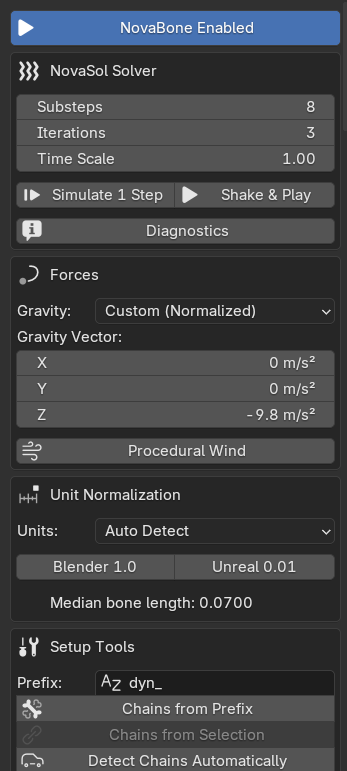
*▲ N패널의 NovaBone 메인 패널 — 모든 설정이 이 한 곳에 모여 있습니다*

---

## 📥 설치

1. `novabone` 폴더 안의 **파일들을 선택해서** zip으로 압축
   > ⚠️ 폴더째 압축하지 마세요. `blender_manifest.toml`이 zip 최상위에 있어야 합니다.
2. Blender → `Edit > Preferences > Get Extensions`
3. 오른쪽 위 `▼` → **Install from Disk** → zip 선택
4. 설치된 NovaBone을 **Enable(활성화)**
5. 3D 뷰포트에서 `N` 키 → **NovaBone** 탭이 생깁니다

**지원 버전**: Blender 4.2 이상 (4.5 LTS, 5.0, 5.2 LTS 테스트 완료)

---

## 🚀 5분 안에 따라하기 (Quick Start)

<video src="assets/quickstart.mp4" autoplay loop muted playsinline style="width:100%;border-radius:6px" title="퀵스타트 흐름"></video>
*▲ 뼈 선택 → 체인 생성 → 재생. 이게 전부입니다.*

1. 아머처 선택 후 **포즈 모드** 진입
2. 물리를 넣고 싶은 뼈들을 전부 선택
   (연결된 꼬리라면: **뿌리 뼈를 마지막에 클릭**, 나머지는 Shift+클릭)
3. N패널 → **Setup Tools** → `Chains from Selection` 클릭
4. 뼈가 살짝 늘어지면 성공! **스페이스바**로 재생
5. 몸 뼈를 움직이면 체인이 물리적으로 따라 흔들립니다 🎉

> 💡 **Shake & Play** 버튼은 뼈를 흔들고 + 재생까지 자동으로 시작합니다.
> 출렁이면 엔진 정상입니다.

---

## 🧭 패널 구조


*▲ 3D 뷰포트 사이드바(N)의 NovaBone 탭*

| 섹션 | 역할 |
|---|---|
| **NovaBone Enabled** | 애드온 전체 스위치 |
| **NovaSol Solver** | 물리 품질·테스트 도구 |
| **Forces** | 중력·바람 |
| **Unit Normalization** | 릭 스케일 보정 |
| **Setup Tools** | 체인 만들기 |
| **Armature** | 오브젝트별 설정 |
| **Chains** | 체인별 상세 물리 |
| **Bake & Reset** | 베이크·리셋 |

---

## 1️⃣ NovaBone Enabled

가장 위의 큰 버튼. **ON이어야 물리가 작동합니다.** 체인 생성 시 자동 ON.
OFF면 물리가 멈추고 애니메이션 원본대로 재생됩니다.

---

## 2️⃣ NovaSol Solver (물리 품질)

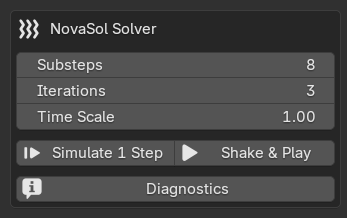

| 항목 | 설명 | 권장값 |
|---|---|---|
| **Substeps** | 프레임 1장을 몇 조각으로 나눠 계산. 높을수록 부드럽고 단단하고 **충돌 아티팩트도 줄어듦** | 8 (접촉 많거나 빠른 장면 10~16) |
| **Iterations** | 제약(길이·각도) 반복 계산 횟수 | 3 |
| **Time Scale** | 물리 시간 속도 (2 = 두 배 빠름, 0.5 = 슬로모션) | 1.0 |

| 버튼 | 역할 |
|---|---|
| **Simulate 1 Step** | 현재 프레임에서 딱 1프레임만 진행 (미세 확인) |
| **Shake & Play** | 뼈를 랜덤하게 흔들고 **자동 재생 시작**. 재생 중 다시 누르면 정지 |
| **Diagnostics** | 엔진 상태·숨은 오류 표시. **문제 발생 시 가장 먼저 클릭** |

> ⚠️ 물리는 **프레임이 바뀔 때** 계산됩니다. 정지 상태에서 안 움직이는 건 정상입니다.

### 🎯 충돌 정밀 엔진 (v1.0.0)

NovaSol의 충돌은 더 이상 뼈당 구 1개가 아닙니다. 매 서브스텝마다:

1. **볼륨 프로빙** — 체인에서 고른 Shape(Capsule / Cylinder / Box)를
   **실제 볼륨** 따라 제한된 수의 구 프로브로 샘플링합니다: 캡슐은 척추선,
   실린더는 측면 링, 박스는 모서리 오프셋까지. 뼈 중간이 벽을 비집고
   지나가던 누수와 "Box인데 둥글게 밀려나던" 문제가 사라졌습니다.
2. **멀티 접촉** — 서로 다른 최대 3개 접촉(법선이 60° 이상 차이)을 동시
   해결: 가장 깊은 접촉은 100%, 나머지는 60% 강도로 밀어냅니다. 모서리에
   걸친 뼈가 한쪽 벽에서만 떨리지 않고 양쪽 모두에 안착됩니다.
3. **스윕 CCD** — 한 서브스텝에 충돌 반경의 절반 이상 이동한 뼈는
   **이동 경로 자체**를 검사해 마지막 안전 지점으로 되돌립니다. 빠른
   휘두름이 얇은 판을 순간 통과하는 터널링이 잡힙니다.
4. **안티폴드** — 모든 접촉 보정에는 예산이 있습니다(라운드당 뼈 길이의
   최대 75%) + 방향 클램프(라운드당 최대 45°). 뼈가 한 번에 뒤집혀
   접히는 것은 구조적으로 불가능하며, 대신 몇 프레임에 걸쳐 표면을
   미끄러져 내려갑니다.
5. **안티킹크** — 접촉 해결 후, 모든 뼈의 방향을 이웃 뼈 평균 방향으로
   15%씩 완만히 혼합(Chain 모드만)합니다. 지그재그뿐 아니라 **되접힘**도
   이 단계에서 펴집니다. 예외는 두 가지, 둘 다 "어디에 작용하는가"에
   대한 것입니다: **표면에 닿아 있는 뼈**는 충돌이 잡아준 자리에 그대로
   두고, 체인의 **양 끝 뼈**는 건드리지 않습니다. 단 그 관절이 실제
   **접힘(90° 초과)** 이면 두 예외가 모두 풀립니다 — 그러지 않으면
   이웃에 되접힌 뼈를 펼 패스가 아예 존재하지 않고, 체인이 표면에
   안착하는 순간 만들어지는 과도 V자 꺽임(실측 최고 96–99°)도 100°
   임계값에서는 그냥 지나쳐 갑니다.
   구 위 10뼈 드레이프 실측: 기존 규칙 최악 관절 176°, 120° 기준 152°,
   90° 기준 87°. 안착 중 꺽임 실측(사용자 씬): 98.8° → 31°.
   접히지 않은 씬은 그대로입니다(하네스 구: 끝단 채터링 0.336 → 0.339,
   안착 높이 0.4355 → 0.4338).

   > 심하게 감기는 체인이라면 양 끝을 **모든 각도에서** 완화하면 완전히
   > 펴집니다(실측 최악 관절 19°, 대신 평범한 드레이프의 모양이 바뀝니다:
   > 안착 높이 0.4355 → 0.2651). 기본값은 위의 보수적 규칙입니다.
6. **잔여 재검사** — 클램프/예산 절단이 발동한 뼈만(평시엔 0회) 충돌
   라운드 끝에 쿼리 1회 + 작은 외부 밀어냄을 추가해, 라운드가 항상
   표면 **바깥에서** 끝나도록 보장합니다.
7. **안쪽 감지** — 이미 표면 뒤로 들어간 프로브도(반지름 + 본 길이의
   절반까지) 다시 밖으로 밀어냅니다. 면 법선 방향 레이가 면의 뒤쪽으로
   빠져나가야 안쪽으로 판정하므로, 날카로운 모서리 바깥의 점을 안쪽으로
   착각하지 않습니다.
8. **밀어내기 분배** — 본의 머리 쪽에 닿은 접촉은 머리에 가까운 만큼
   부모의 끝도 함께 밀어서, 본이 자기 머리를 축으로 크게 돌지 않습니다.
   첫 번째 본의 머리는 부모에 고정돼 있어서 그 본은 혼자 받습니다.
9. **뿌리 완화** — 그 첫 번째 본은 머리가 이미 반경보다 가까이 있어도 전체
   반경을 지키라고 요구받지 않습니다. 프로브가 지켜야 하는 거리가 머리의 실제
   거리에서 끝의 전체 반경까지 서서히 커집니다 (Probe 모드).
10. **묻힌 부분은 건드리지 않음** — 체인의 뿌리에서 끊기지 않고 이어지는 구간 중
    애니메이션이 이미 닫힌 충돌체 속에 묻어 둔 부분은 충돌로 취급하지 않습니다.

> 💡 전부 자동입니다 — 새 슬라이더 없음. 패널 하단 `Solve xx ms`가
> 오르면 Substeps를 먼저 낮추세요. 프로브 밀도가 좋아져서 예전만큼
> Substeps가 필요 없습니다.

#### Contact Mode: Probe (Fast) vs Precise (Mesh) — v1.1.0

위 설명은 전부 기본값인 **Probe (Fast)** 기준입니다: 뼈 볼륨을 서브스텝당
최대 16개 구 프로브로 샘플링합니다. 프로브는 자기 구가 표면에 닿아야만
접촉을 보고할 수 있으므로, **두 프로브 사이에 끼어 있는 작은 형상**은
깊이가 과소 측정됩니다.

**Precise (Mesh)**는 그 측정 자체를 바꿉니다. 삼각화된 캡슐 프록시를
콜라이더 BVH와 교차시키고(`BVHTree.overlap`, C 레벨 순회), 후보 삼각형마다
뼈의 실제 선분과의 최단 거리를 계산합니다. 따라서 보고되는 깊이가 정확하고
샘플 사이로 빠져나가는 누수가 구조적으로 불가능합니다.

| | Probe (Fast) | Precise (Mesh) |
|---|---|---|
| 접촉 깊이 | 샘플링 | 정확 |
| 두 프로브 사이의 작은 형상 | 과소 측정 (0.1 단위 판에서 0.0086 ≈ 9% 측정됨) | 정확 (0.0000) |
| 솔브 비용 | 1배 | 6뼈 체인 실측 3.0배(Capsule)·2.0배(Box)·1.8배(Cylinder) — Substeps 8 권장 |
| 충돌 형상 | 체인의 Shape (Capsule / Cylinder / Box) | 뼈의 캡슐 + Shape 프로브 깊이를 **바닥값**으로 유지 |

> ⚠️ 마지막 줄 설명: Precise는 뼈의 **캡슐**을 정확히 측정하지만, 프로브보다
> **얇게** 밀어내지는 않습니다. 프로브가 이미 본 면마다 둘 중 **큰 깊이**를
> 유지하므로, 체인을 Precise로 바꿨다고 해서 예전보다 더 깊이 파고들 수는
> 없습니다 — 원통 체인을 옆에서 접근시켜 검증했는데, 캡슐만 쓰면 Radius 0.25
> 에서 0.011 더 얕게 나왔습니다(실린더의 측면 프로브는 반경의 최대 1.8배
> 표면을 모델링합니다). 정확한 측정은 프로브가 과소 측정했던 곳에서만
> 더 밀어낼 뿐입니다.
>
> 같은 6뼈 구 씬 실측: 안착 높이는 유지되고(Cylinder 0.3753 → 0.3753,
> Box 0.3734 → 0.3744) 끝단 채터링은 좋아집니다(Cylinder 0.348 → 0.277,
> Box 0.366 → 0.277). Box를 박스답게 만들려고 쓰는 옵션이 아니라 벽이
> 얇거나 모서리가 날카로운 곳에 쓰는 옵션입니다.

---

## 3️⃣ Forces (중력·바람)

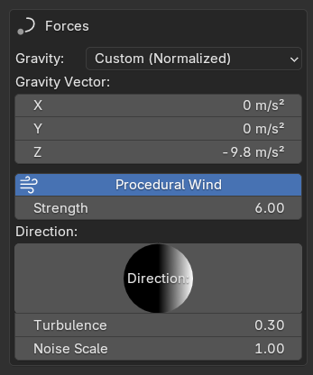
*▲ Procedural Wind를 켠 모습*

### Gravity

| 모드 | 설명 |
|---|---|
| **Custom (Normalized)** | 기본. 벡터 직접 입력 (기본 0,0,-9.81). 스케일 무관 동일 느낌 |
| **Scene Gravity** | 씬 중력 설정 사용 |
| **Zero** | 무중력 |

### Procedural Wind (내장 바람)

<video src="assets/wind.mp4" autoplay loop muted playsinline style="width:100%;border-radius:6px" title="바람 시뮬"></video>
*▲ 바람 ON + 재생만으로 머리카락이 계속 살랑입니다*

| 항목 | 설명 |
|---|---|
| **Strength** | 바람 세기 (6~10이면 확실히 보임) |
| **Direction** | 바람 방향 |
| **Turbulence** | 난기류 — 높을수록 랜덤 출렁임 |
| **Noise Scale** | 패턴 크기. 낮으면 큰 물결, 높으면 잘게 |

> 💡 재생만으로 지속 움직임을 원하면 바람을 켜세요.

---

## 4️⃣ Unit Normalization ⭐ (스케일 문제 해결)

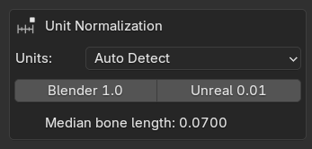

**"블렌더 릭은 뼈 길이 1.0, 언리얼 임포트는 0.01이라 같은 값이 안 먹는다"**
는 고질 문제의 해결 기능. 모든 물리량을 **기준 뼈 길이(L)로 나눈 정규화
공간**에서 계산하므로 같은 값 = 어떤 스케일에서든 동일한 움직임.

| 항목 | 설명 |
|---|---|
| **Auto Detect** | 기본. 체인 뼈 길이 중간값을 자동 기준으로 사용. **대부분 이대로면 끝** |
| **Manual** | 기준 길이 직접 입력 |

**스케일 프리셋**: `Blender 1.0` / `Unreal 0.01` 버튼 한 번 클릭으로 끝.

<video src="assets/unit_presets.mp4" autoplay loop muted playsinline style="width:100%;border-radius:6px" title="스케일 프리셋"></video>
*▲ 아래 표시되는 `Median bone length`가 자동 감지된 기준값입니다*

---

## 5️⃣ Setup Tools (체인 만들기)

### Bone Prefix (접두사) — 게임 릭 추천

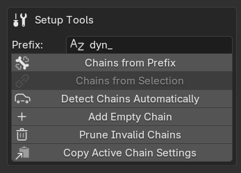
*▲ dyn_ 뼈들이 한 번에 체인화됩니다*

1. **Prefix**에 접두사 입력 (기본 `dyn_`)
2. **Chains from Prefix** 클릭
3. 접두사 뼈 전부 자동 체인화

| Mode | 동작 |
|---|---|
| **Group Chains** | 연결된 dyn_ 뼈들은 하나의 체인으로 (권장) |
| **Individual Bones** | 각각 독립 1뼈 체인 (액세서리 다수에 유용) |

### Chains from Selection

1. 포즈 모드에서 뼈 선택 — **뿌리 뼈를 마지막에 클릭**
2. 버튼 클릭

| Mode | 동작 |
|---|---|
| **Auto** | 경로가 있으면 체인, 없으면 개별 체인 자동 처리 (권장) |
| **Chain to Active** | 활성 뼈 아래로 연결된 것만 |
| **Individual Bones** | 선택 뼈 각각 독립 체인 |

> ✅ **뼈 1개만 선택해도 됩니다**: 뼈를 딱 1개 선택하고 실행하면
> 1뼈 체인(Start = End = 그 뼈)이 생성됩니다. 더 이상
> "No chain created" 경고가 나오지 않습니다. Auto 모드에서 활성(뿌리)
> 뼈가 조용히 빠지던 문제도 수정되었습니다.

> 💡 **액세서리 여러 개 한 번에**: 목걸이·귀걸이 뼈들을 전부 선택하고 Auto로
> 실행하면 각자 개별 체인이 되어 한꺼번에 물리가 걸립니다.

### Detect Chains Automatically

선택 없이 **자식 없는 끝 뼈(팁)를 자동으로 찾아** 연속 구간을 체인화.
릭 구조를 몰라도 됩니다.

| 버튼 | 역할 |
|---|---|
| **Add Empty Chain** | 빈 체인 추가 (Start/End 수동 입력용) |
| **Prune Invalid Chains** | 깨진 체인 일괄 정리 |
| **Copy Active Chain Settings** | 활성 체인 설정을 다른 모든 체인에 복사 |
| **Resolve From Start/End** | Start/End 뼈 이름만으로 경로 자동 완성 |
| **Select Chain Bones** | 체인 뼈들을 뷰포트에서 선택 |

### Fix Bone Orientation (본 방향 교정)

언리얼에서 가져온 본은 체인 방향을 향하지 않는 경우가 많아서, 다이내믹스 솔버가
옆으로 흔들어 버립니다. 이 패널(탭 **NovaBone → Fix Bone Orientation**, 기본은
닫힘)이 본의 꼬리 방향을 다시 맞춥니다. **헤드는 절대 움직이지 않습니다.**

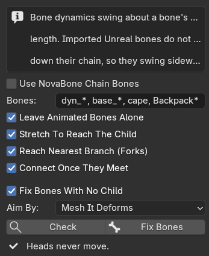

| 항목 | 설명 |
|---|---|
| **Use NovaBone Chain Bones** | 이 아마추어의 체인에 이미 들어 있는 본만 교정합니다. 이름 패턴은 무시됩니다 |
| **Bones** | 교정할 본. 쉼표로 구분하고 `*`는 아무 문자열, 비우면 모든 본. 기본값 `dyn_*, base_*, cape, Backpack*` |
| **Leave Animated Bones Alone** | 위치·회전·스케일에 키가 있는 본(액션 또는 NLA)은 건너뛰어 애니메이션이 바뀌지 않게 합니다. 끄면 캐릭터가 접힐 수 있습니다 |
| **Stretch To Reach The Child** | 꼬리가 자식의 헤드에 닿을 때까지 본을 늘려 체인을 이어 줍니다. 메시는 움직이지 않습니다 |
| **Reach Nearest Branch (Forks)** | 자식이 여러 개인 본은 가장 가까운 자식에 닿게 해서 메인 가지가 이어지게 합니다 |
| **Connect Once They Meet** | 헤드가 부모의 꼬리에 놓인 본은 Connected를 켭니다 |
| **Fix Bones With No Child** / **Aim By** | 마지막 본이 향할 곳: Mesh It Deforms, Gravity (Down), Along Its Parent, Leave Them Alone |
| **Check** | 바뀔 본의 수를 세고, 키 때문에 건드리지 않은 본의 이름을 보여줍니다. 아무것도 바꾸지 않습니다 |
| **Fix Bones** | 본 방향을 맞추고, 스킨된 메시가 움직였는지 보고합니다 |

자식이 헤드 위에 정확히 얹힌 본(`MSTR_x` / `x_1` 쌍)은 그 자식 방향으로 돌립니다.

---

## 6️⃣ Armature 섹션

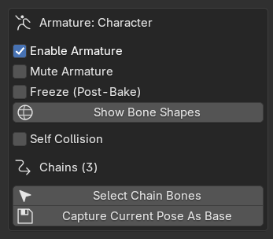

| 항목 | 설명 |
|---|---|
| **Enable Armature** | 이 아머처 물리 ON/OFF |
| **Mute Armature** | 일시 정지 |
| **Freeze (Post-Bake)** | 베이크 후 물리 중단 (결과 보존) |
| **Show Bone Shapes** ⭐ | **충돌 셰이퍼 표시** |
| **Self Collision** | 체인 뼈들끼리 서로 밀어냄 |

### Show Bone Shapes — 충돌 셰이퍼 ⭐

<video src="assets/shapes.mp4" autoplay loop muted playsinline style="width:100%;border-radius:6px" title="셰이퍼 표시"></video>
*▲ 캡슐이 본 헤드~테일에 정확히 걸쳐서 함께 움직입니다. Radius를 올리면 지름이 커집니다*

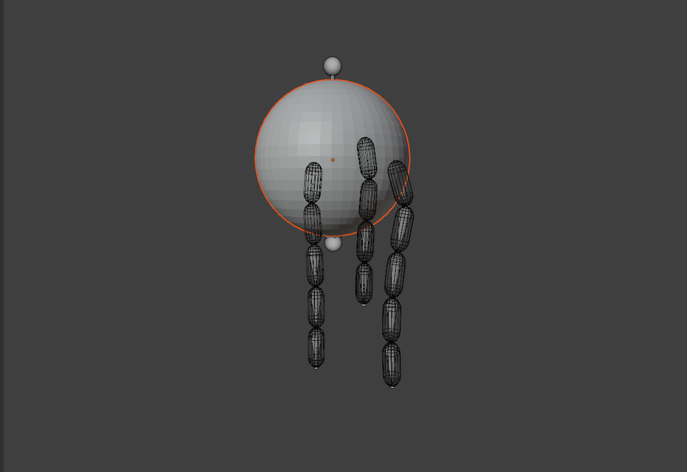
*▲ 머리카락 체인을 둘러싼 캡슐과 충돌 대상*

**셰이퍼는 새 뼈가 아닙니다.** 뼈의 충돌 범위를 **눈으로 보여주는 시각화 메쉬**입니다.

- Capsule / Cylinder / Box 중 선택
- **Radius** = 충돌 두께 (뼈 길이 대비 비율 — 스케일 무관)
- 재생 중에도 물리 뼈에 픽셀 단위로 정확히 부착
- Legacy Physics (Collision) 엔진에서는 이 셰이퍼가 **실제 충돌체** 역할
- NovaSol 엔진에서도 이제 고른 Shape가 **실제 충돌 볼륨**으로 사용됩니다
  (위 충돌 정밀 엔진 참고)

> 💡 튜닝 절차: Show Bone Shapes ON → Radius 조절 → 캡슐이 몸에 살짝
> 겹치는 지점이 "충돌 시작 지점"입니다.

---

## 7️⃣ Chains (체인별 설정)

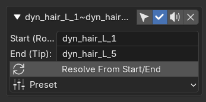
*▲ 체인 헤더: 선택, 활성, 음소거, 삭제 / Start·End 본 / Preset*

체인 박스의 `▼`를 눌러 펼칩니다.

**체인 행 헤더**: `[▼] [이름] [🎯선택] [✓ 시뮬ON/OFF] [🔇 음소거] [X 삭제]`

> 🎯 **체인별 선택 버튼** — 체인이 10~20개 이상 나열되어도 각 행의
> 선택 버튼을 누르면 **그 체인의 뼈만** 뷰포트에서 선택되고, 동시에 그
> 체인이 활성 체인이 됩니다(이어서 Preset/설정 복사를 누르면 클릭한 그
> 체인에 적용). 어떤 체인이 어떤 뼈인지 더 이상 추측할 필요 없습니다.

### 🎵 Motion (움직임 타입)

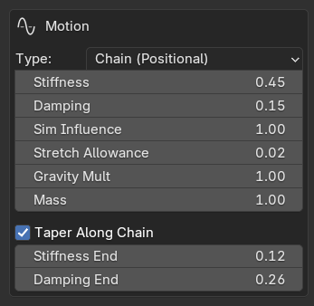
*▲ Chain (Positional) 설정. Taper Along Chain을 켜면 Stiffness End / Damping End가 나타납니다*

<video src="assets/sim_follow.mp4" autoplay loop muted playsinline style="width:100%;border-radius:6px" title="애니메이션되는 머리를 따라가는 머리카락"></video>
*▲ 머리를 좌우로 움직이면 머리카락 체인이 한 박자 늦게 따라와서 되돌아 흔들립니다 (Chain 모드, Hair 프리셋)*

| Type | 설명 |
|---|---|
| **Chain (Positional)** | 기본. 안정적인 위치 기반 물리. 오버슈트 없음. 안티킹크 스무딩 적용 |
| **Spring (Force)** | **스프링 지글본**. 통통 튀며 여러 번 출렁. 가방·가슴·배에 최적 |

| 항목 | Chain에서 | Spring에서 |
|---|---|---|
| **Stiffness** | 목표 추적 강도 | 스프링 상수 k |
| **Damping** | 속도 감쇠 | 속도 저항 c (낮을수록 오래 출렁) |
| **Taper Along Chain** | 끝으로 갈수록 말랑 (ON 권장) | 동일 |
| **Influence** | 0=애니메이션, 1=물리, 중간=블렌딩. 최종 포즈가 (1−influence) 비율로 원본 애니와 섞이고, 섞인 포즈는 충돌체 밖으로 다시 밀어냅니다. 그래도 **충돌 장면에서는 1.0이 가장 정확합니다** | 동일 |
| **Stretch** | 뼈 늘어남 허용치 (0.2 = ±10%). **충돌 장면에선 0 권장** | 동일 |
| **Gravity / Mass** | 중력 배율 / 무게감 | 동일 |

### 📐 Limits

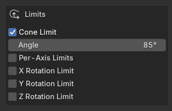

| 항목 | 설명 |
|---|---|
| **Cone Limit** | 뿌리 기준 최대 꺾임 각도 |
| **Per-Axis Limits** | X/Z 축별 제한 (스커트 등) |

### 🥚 Bone Collision Shape

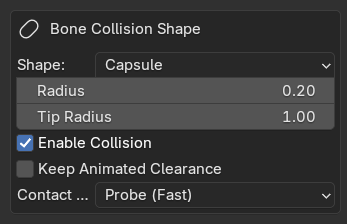

| 항목 | 설명 | 접촉 장면 권장값 |
|---|---|---|
| **Shape** | Capsule(권장) / Cylinder / Box — **세 모양 모두 NovaSol에서 실제 형태로 충돌** | Capsule |
| **Radius** | 충돌 두께 (비율 — 스케일 무관) | 0.18~0.25 |
| **Tip Radius** | 마지막 본의 반경을 Radius에 대한 비율로 (1 = 처음부터 끝까지 같음) | 1 |
| **Keep Animated Clearance** | 전체 Radius까지 밀어내지 않고 애니메이션 포즈가 이미 가진 간격만 유지 | OFF; 두피에 붙은 머리카락이면 ON |
| **Enable Collision** | 이 체인의 충돌 ON/OFF | ON |
| **Margin** | 반경 바깥 여유 두께 | 0.02~0.05 |
| **Friction** | 접촉 시 접선 속도 감쇠 | 0.4~0.6 |
| **Bounce** | 접촉 반발 | 0.05~0.15 (높으면 꺽임 재발) |

### ⚙️ Collision Engine

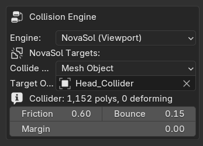
*▲ NovaSol 엔진 + 충돌 대상 지정*

<video src="assets/sim_collision_sweep.mp4" autoplay loop muted playsinline style="width:100%;border-radius:6px" title="체인을 쓸고 지나가는 충돌체"></video>
*▲ 움직이는 충돌체가 늘어진 체인을 쓸고 지나가면 체인이 밀려났다가 돌아옵니다*

<video src="assets/collision_demo.mp4" autoplay loop muted playsinline style="width:100%;border-radius:6px" title="충돌 데모"></video>
*▲ NovaSol 충돌: 팔을 움직이면 머리카락이 몸에서 밀려납니다*

| Engine | 설명 |
|---|---|
| **NovaSol (Viewport)** | 내장 솔버가 실시간 밀어냄 — 볼륨 프로빙, 멀티 접촉, 스윕 CCD, 안티폴드, 안티킹크 전부 적용. **Collide With** = Mesh Object 또는 Collection |
| **Legacy Physics (Collision)** | 셰이퍼가 **진짜 블렌더 충돌 오브젝트**로 변신. 예전 Cloth 수정자, 파티클 Hair, Softbody용. Blender 5.2 시뮬레이션 노드는 이걸 무시합니다 |
| **Simulation Nodes (5.2+)** | 체인이 Blender **Hair Dynamics** 솔버가 돌리는 헤어 스트랜드가 되고, 충돌 대상에는 **Collider** 노드 그룹이 붙습니다. Blender 5.2 이상 필요 |

**Legacy Physics Profile**: Hair(얇은 껍질·저마찰) / Cloth(두꺼운 껍질·고감쇠) / Custom

**External Targets**: 본이 붙은 **자기 옷이 아니라** 상대 캐릭터·바닥·다른 의상 등
**외부 충돌체** 지정. `Add GN Collider to Targets`로 공식 Collider 수정자 추가.

> ⚠️ **클로스 연동 순서**: ① Show Bone Shapes ON ② 옷에 Cloth 수정자
> ③ Cloth의 **Cloth Collisions 체크** ④ 재생

#### Simulation Nodes (5.2+)

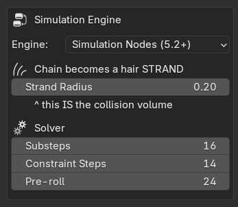
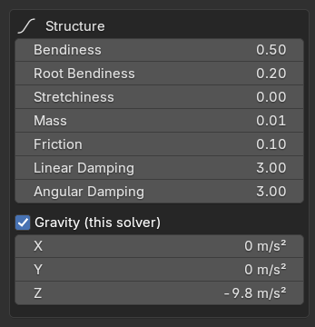
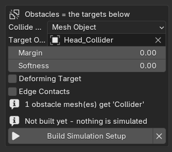
*▲ Simulation Nodes 엔진의 Engine, Solver, Structure, Gravity, Obstacles*

1. Engine = **Simulation Nodes (5.2+)**
2. **Collide With** = 몸 메시 또는 컬렉션
3. **Build Simulation Setup** 클릭 (옆의 ✕는 셋업을 지웁니다)

| 항목 | 설명 |
|---|---|
| **Strand Radius** | 스트랜드 두께 — 이게 곧 충돌 볼륨입니다. 바로 반영 |
| **Substeps / Constraint Steps** | 솔버 자체의 품질 설정 |
| **Pre-roll** | Build 때 스트랜드를 안착시키는 프레임 수. 재생 시작부터 떨어지는 동작이 나오지 않게 합니다 |
| **Bendiness / Root Bendiness / Stretchiness / Mass** | 스트랜드 구조 |
| **Friction** | 장애물과의 마찰 |
| **Linear / Angular Damping** | 떨리면 / 채찍처럼 휘면 올리세요 |
| **Gravity (this solver)** | NovaSol 중력은 이 솔버에 적용되지 않습니다 |
| **Margin / Softness / Deforming Target / Edge Contacts** | 장애물의 Collider 설정. 변형되는 메시(아마추어·셰이프키)면 Deforming Target 체크 |

위 슬라이더는 다시 Build하지 않아도 바로 반영됩니다. 씬의
**Time Scale**도 적용됩니다. **Pre-roll**이나 체인 본을 바꾸면 Build를
다시 누르세요.

> 💡 장애물 메시 하나에는 Collider 설정이 하나만 붙으므로, 두 체인이
> 같은 장애물을 쓰면 마지막에 Build한 체인의 Margin / Friction이
> 적용됩니다.

### 🎈 Floating Head

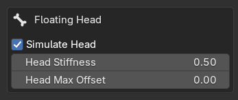

`Use Connect`가 꺼진 분리 뼈(장신구 등)의 **머리 끝도 물리로 시뮬**합니다.

| 항목 | 설명 |
|---|---|
| **Simulate Head** | 헤드 시뮬 ON |
| **Head Stiffness** | 원위치로 당기는 힘 |
| **Head Max Offset** | 최대 이탈 거리 (0 = 무제한) |

### 🎯 Capture Current Pose As Base

체인 목록 아래에 있습니다. 키프레임이 없는 본은 Stiffness에 의해
**기본 자세** — 체인을 만들 때의 자세 — 쪽으로 당겨집니다. 본을 쉬는
자세로 잡고 이 버튼을 누르면 그게 새 기본 자세가 됩니다. 체인을 다시
만들어도(체인 추가·삭제, Copy Settings, Undo) 기본 자세는 유지됩니다.

---

## 8️⃣ Bake & Reset

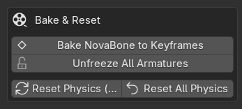

| 버튼 | 설명 |
|---|---|
| **Bake NovaBone to Keyframes** | 재생 구간 전체를 시뮬해 **키프레임으로 굽기**. 게임 엔진 반출 필수. Preroll로 시작 전 안정화 |
| **Unfreeze All Armatures** | 베이크 후 Freeze 해제 |
| **Reset Physics (Active)** | 활성 아머처 물리 초기화 |
| **Reset All Physics** | 씬 전체 초기화 |

---

## 🎨 프리셋 가이드

| 프리셋 | 느낌 | 용도 |
|---|---|---|
| **Hair** | 부드럽게 흘러내림 | 머리카락 |
| **Jelly** | 젤리 출렁임 | 뚱한 장식 |
| **Cloth** | 천처럼 느슨 | 스카프, 리본 |
| **Tail** | 둥글게 휘어짐 | 꼬리 |
| **Accessory** | 단단하게 흔들림 | 귀걸이, 목걸이 |
| **Antenna** | 거의 안 휘어짐 | 안테나, 깃털 |
| **Jiggle** | 크게 처지고 출렁 | 가슴, 배 |
| **Spring** ⭐ | 스프링처럼 통통 | 스프링 지글본 |

---

## 📋 시나리오 레시피

<details>
<summary><b>👱 머리카락</b></summary>

1. 머리 뼈 선택 (뿌리 마지막 클릭) → `Chains from Selection`
2. Preset: **Hair**
3. Show Bone Shapes ON → Radius 조절
4. Collision: NovaSol + 몸통 메시 지정, **Influence 1.0**, Bounce 0.1, Margin 0.03
5. 재생해서 팔이 머리를 스칠 때 밀려나는지 확인

</details>

<details>
<summary><b>👝 액세서리 여러 개</b></summary>

1. 액세서리 뼈 전체 선택 → `Chains from Selection` (Auto)
2. 하나 튜닝 후 **Copy Active Chain Settings**로 전체 복사
3. 각 행의 🎯 선택 버튼으로 어떤 체인이 어떤 뼈인지 바로 확인

</details>

<details>
<summary><b>🎒 스프링 가방</b></summary>

1. 가방 체인 생성 → Preset: **Spring**
2. Shake & Play → 통통 출렁임 확인
3. Damping ↑ = 빨리 잠잠

</details>

<details>
<summary><b>🩳 스커트</b></summary>

1. Prefix가 있으면 `Chains from Prefix`
2. Preset: **Cloth**
3. Cone Limit 60~70°
4. Self Collision ON (치맛자락 겹침 방지)

</details>

<details>
<summary><b>🧵 클로스 연동</b></summary>

1. Engine = **Legacy Physics (Collision)**, Profile = **Cloth**
2. **Show Bone Shapes ON**
3. 옷에 Cloth 수정자 → **Cloth Collisions 체크**
4. 재생

</details>

<details>
<summary><b>⛓️ 구/몸통 위에 체인 드레이프시키기 (접촉 튜닝)</b></summary>

<video src="assets/sim_drape.mp4" autoplay loop muted playsinline style="width:100%;border-radius:6px" title="구 위에 드레이프되는 체인"></video>
*▲ 체인이 구 위로 떨어져 표면을 따라 늘어집니다 (Cloth 프리셋, Stiffness 0)*

1. Influence **1.0**, Stretch **0**, Stiffness **0.05~0.1** 정도
2. Bounce **0.05~0.15**, Friction **0.4~0.6**, Margin **0.03**
3. Radius 0.18~0.25, Substeps 12
4. 재생 — 체인이 표면을 따라 늘어져 미끄러져야 합니다. 접힘·꺽임 없이

</details>

---

## 🔧 문제 해결

<details>
<summary><b>물리가 안 움직여요</b></summary>

1. NovaBone Enabled / Enable Armature ON 확인
2. Freeze OFF 확인
3. **스페이스바 재생 중인지** (정지 시 물리도 멈춤 — 정상)
4. Shake & Play 클릭 → 출렁이면 정상
5. **Stiffness가 너무 높지 않은지** — 0.5 이상이면 체인이 기본 자세를
   거의 그대로 유지합니다. 늘어져야 하는 머리카락은 0.05~0.1
6. Diagnostics → 콘솔(`Window > Toggle System Console`) 확인

</details>

<details>
<summary><b>캐릭터를 충돌 대상으로 쓸 때</b></summary>

1. **캐릭터 전체를 대상으로 쓰지 마세요.** 머리와 몸만 복제해서 평범한 충돌용
   메시로 만들고 나머지(머리카락 카드, 귀걸이, 체인 본을 따라 움직이는 옷)는
   지웁니다. 대상 메시 중 **시뮬레이션 본에 스키닝된 부분**은 본과 같이
   움직이므로, 체인이 자기가 끌고 다니는 형상과 충돌할 수 있습니다.
2. 충돌용 복제본을 **Collide With**에 지정합니다.
3. 두피 속에 묻힌 머리카락 뿌리는 이제 괜찮습니다. 뿌리가 표면 바로 위에
   놓인 경우에는 **Radius** × 본 길이가 유지하는 간격입니다: Radius를 낮추거나
   **Keep Animated Clearance**를 켜세요.
4. 변형되는 머리(얼굴 본, 셰이프키)는 별도 설정이 필요 없습니다. 움직이는 면을
   닿는 지점에서 측정합니다.
5. 먼저 충돌용 복제본으로 시험해 보세요: 안정되면 원래 대상에 체인에 스키닝된
   형상이 들어 있던 것입니다.

</details>

<details>
<summary><b>NovaSol 충돌이 안 막혀요</b></summary>

1. Enable Collision ON + 몸통 메시 지정 확인
2. **Sim Influence 1.0 확인** — 낮으면 보이는 포즈가 원본 애니 쪽으로
   되감겼다가 다시 밀려 나와서, 시뮬레이션 자체보다 덜 정확합니다
3. Radius 0.2~0.3, Margin 0.02~0.05
4. 패널 하단 `Collider failed: 이름` 표시 확인
5. 빠른 움직임 → Substeps 10~16 (스윕 CCD도 자동 작동)

</details>

<details>
<summary><b>접촉부 뼈 몇 개가 접히거나 꺽여요</b></summary>

1. v1.0.0 솔버 사용 확인 (안티폴드 + 안티킹크 내장)
2. Bounce 0.1로, Friction 0.4~0.6으로 낮추기
3. Substeps 10~16 — 서브스텝당 파묻힘이 얕아져 접힘 방지 장치가
   거의 발동하지 않아 더 부드럽습니다
4. 설정 변경 후 Reset Physics

</details>

<details>
<summary><b>클로스가 안 부딪혀요</b></summary>

1. Show Bone Shapes ON 확인
2. 옷의 Cloth 수정자에서 **Cloth Collisions 체크**
3. Engine = Legacy Physics (Collision) + Profile = Cloth

</details>

<details>
<summary><b>뼈가 튀어요 / 밀려나요</b></summary>

1. 물리 뼈에서 **컨스트레인트(IK 등) 제거** — 시뮬 뼈는 순수하게
2. Reset Physics
3. 비균준 오브젝트 스케일 지양

</details>

<details>
<summary><b>Fix Bones(본 방향 교정)가 크래시 나거요 아무 것도 안 돼요</b></summary>

1. 자식 뼈가 부모 머리 위에 정확히 얹힌 경우(언리얼 `MSTR_x` / `x_1` 쌍)는
   그 자식 방향으로 돌립니다. Check에는 "child-on-head (aimed along the
   child)"로 집계됩니다
2. 실행 전 **Check**를 먼저 누르면 몇 개가 틀어졌는지, 위치/회전/스케일에 키가
   있어서 건드리지 않은 본이 무엇인지 이름으로 보여줍니다
3. 그런 키가 있는 본은 일부러 건너뜁니다: 방향을 바꾸면 키가 메시에 하는 일이
   달라지기 때문입니다. **Leave Animated Bones Alone**을 끄면 건너뛰지 않지만
   캐릭터가 접힐 수 있습니다
4. **Use NovaBone Chain Bones**를 켜면 이름 패턴은 무시됩니다

</details>

---

## ❓ FAQ

**Q. NovaShape_* 오브젝트는 뭔가요?**
충돌 범위 시각화입니다. Show Bone Shapes를 끄면 자동 삭제되며 렌더에는 항상 숨겨집니다.

**Q. 게임 엔진으로 어떻게 가져가나요?**
`Bake NovaBone to Keyframes` 후 FBX 익스포트. 게임 엔진은 베이크된 애니를 재생합니다.

**Q. 새 충돌 방식의 성능은?**
볼륨 프로빙은 뼈당 타깃당 최대 ~16회 구 쿼리로 제한되고, 멀티 접촉·CCD는
**접촉 프레임에만** 추가 비용이 발생합니다. 패널 하단의 체인별 계산 시간(ms)을
보면서 조절하고, 오르면 Substeps를 먼저 낮추세요 — 프로브 밀도가 좋아져서
예전만큼 Substeps가 필요 없습니다.

**Q. 뼈 1개짜리 액세서리도 되나요?**
됩니다. 이제 `Chains from Selection`에 뼈를 딱 1개만 선택해도 바로 1뼈
체인이 생성됩니다. Individual 모드나 Detect Chains의 Include Single Bones도
가능합니다.

**Q. 어떤 체인이 어떤 뼈인지 어떻게 아나요?**
그 체인 행의 🎯 버튼을 누르세요 — 해당 뼈들이 뷰포트에서 선택되고 그
체인이 활성화됩니다.

---

## 📜 라이선스

```
GNU GENERAL PUBLIC LICENSE
Version 3, 29 June 2007
```

이 프로젝트는 Blender 표준 라이선스인 **GPL-3.0**을 따릅니다.
전체 라이선스 전문은 [LICENSE](./LICENSE) 파일을 참고하세요.

---

**Made by Chamiseul** 🦴
