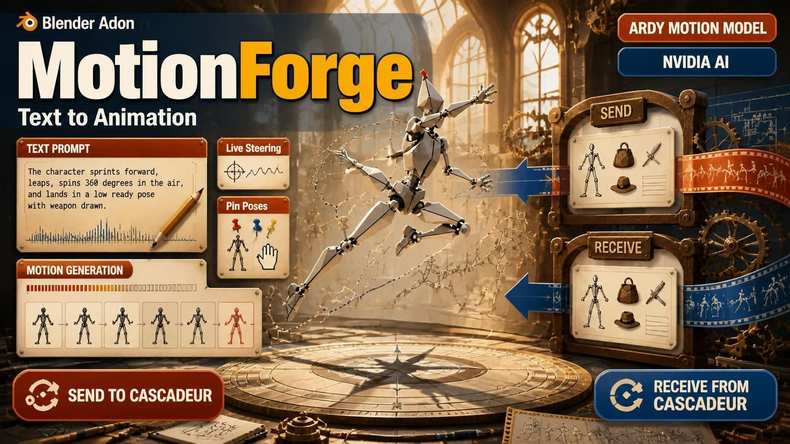

# 🦴 NovaBone Dynamics

**Bone-chain physics simulation add-on** — turn hair, tails, skirts,
accessories and jiggle bones into automatic physics animation with a
few clicks.

**Author: Chamiseul**

🇺🇸 English | [🇰🇷 한국어](./KO_index.md)

---

## 🆕 What's New in v1.3.0

Everything since v1.2.0 is listed here. The numbers are measured on test
rigs (a chain over a sphere, a chain touching near its root, the same chain
with a keyed root bone), each run from a clean cache.

### Fix Bones: master bones are aimed, and only real animation blocks a bone

- **A bone whose child sits on its head is now aimed along that child.**
  Unreal rigs pair a short master bone (`MSTR_hair_back_r`) with its first
  link at the very same joint. There is no gap to close and no direction to
  point at, so these bones used to be left alone, still pointing the way the
  exporter left them. They now follow the child's own axis, the line the chain
  actually runs along. Length does not change, and Fix Bones still checks that
  the skinned mesh did not move.
- **Only keys on a bone's own pose channels (location, rotation, scale) block
  it.** A keyed custom property or constraint influence does not move the mesh
  when the bone is re-aimed, but it used to mark the whole bone as animated.
- **Check lists the bones it left alone** because of keys, by name, instead of
  only counting them.

### Hair roots buried in the character no longer throw the chain around

On a character the collision target is usually the body itself, and a hair
root sits **inside** the scalp, an earring stud inside the ear. That part of
the chain was put there by the animation; the solver treated it as a
collision and pushed it out about a root that cannot move, which threw the
whole chain around.

The part of the chain that the **animated** pose already buries in the
collider, counted unbroken from the chain's root, is now left alone. A bone
that the animation swings through the collider from the middle of the chain
is still a collision. Meshes that are not closed volumes (a plane, a cloth)
have no inside and are never treated as buried.

Measured with the root of a chain 0.14 m inside a sphere (distance of the
tip from its animated position, before → after): static root **0.395 →
0.087 m**, moving root **0.570 → 0.147 m**, soft chain **0.589 → 0.186 m**,
sharpest joint 89° → 28° with the root moving. A chain buried deeper (half
of it inside) stays on its animation as before (0.040 → 0.047 m).

> 💡 If the simulation still goes wild with the whole character as the
> target, see Troubleshooting — "A character as the collision target".

### The first bone no longer swings hard around its fixed head

The chain's first bone hangs from an animated parent, so its head cannot
move. When a collider sat closer to that head than Radius, every contact
pushed the bone out to the **full** Radius about a pivot that stayed put —
the "ぐきぃ" kink right below the root. The distance a bone has to keep now
grows from the head's real gap up to the full Radius at the tip, so the bone
leans away just enough.

Measured over 12 settings (3 Radius × 2 Stiffness × static / moving root) at
4 collider positions each: the first bone's deviation from its animated
direction **57° → 16°**, the sharpest joint **58° → 16°**, jerk **0.065 →
0.011**, chatter 0.0225 → 0.0161, penetration 0 before and after. No setting
got worse. Probe mode only — **Precise** keeps the exact full-radius contact.

### Influence below 1 no longer lets the pose into the collider

Influence mixes the simulated pose with the raw animation, and the animation
knows nothing about the collider, so a mix could end up inside it. The mixed
pose is now pushed out again, and the bones below it follow, so the chain
stays joined. Penetration on a chain pulled through a sphere: Influence 0.5
**0.062 → 0**, Influence 0.3 **0.098 → 0**.

### New: Tip Radius

*Bone Collision Shape → Tip Radius.* The collision radius of the **last**
bone as a fraction of Radius; bones in between taper linearly. 1 (default)
keeps the same radius all along. The bone shapes drawn by *Show Bone Shapes*
follow it.

### New: Keep Animated Clearance

*Bone Collision Shape → Keep Animated Clearance* (off by default). Where the
animated pose already sits closer to the collider than Radius — hair resting
on a scalp — the bone keeps only that gap instead of being pushed out to the
full Radius. The allowed gap drops at once and grows back at 40% a frame, and
never goes below 30% of Radius, so the bone cannot sink into the surface.
Measured: tip distance from the animated pose **0.054 → 0.042** (−23%),
jerk **0.027 → 0.017** (−35%), penetration 0.

### Stiffness now works in Chain mode

In Chain mode the Stiffness pull was computed and then thrown away, so
**Stiffness did nothing** — 0, 0.3 and 0.6 gave the exact same motion.
Head Stiffness (Floating Head) had the same bug and never pulled the head
back. Both work now.

> ⚠️ **Existing scenes will look stiffer.** Every Chain-mode scene and
> preset was tuned with no Stiffness at all. If a chain now holds itself
> up too much, lower Stiffness: around **0.05–0.1** drapes, 0.5 already
> holds a chain nearly straight against gravity.

### Thin chains no longer sink into colliders

A probe deeper inside the collider than its own radius was not detected,
so once a point got that deep it kept sinking. A point behind the surface
is now detected (confirmed by a ray through the back of the face, so a
point outside a sharp edge is not mistaken for one inside).

Penetration depth with Radius 0.01: chain over a sphere **0.028 → 0.006**
(worst 0.073 → 0.018), the same chain with a moving root **0.089 → 0.0003**,
Suzanne **0.196 → 0.008**, cube 0.011 → 0.0004. A normal Radius is
unchanged.

### Contacts near a bone's root no longer kink it

When a collider touched a bone near its **head**, only the tail was pushed.
The bone swung hard around its head while the parent did not move, so the
chain kinked right below the touched joint. The push is now shared: the tail
takes the part for where along the bone the contact is, and the **parent's
tail** (this bone's head) takes the rest.

Measured over 7 scenes (5 collider positions each): jerk lower in six and
level in one — chain with a moving root and Radius 0.01 **0.166 → 0.035**,
the same chain at rest 0.123 → 0.035, collider at a bone's head 0.176 →
0.093; collider near the root, sharpest joint 29° → 16°. Chatter stays under
0.04 everywhere.

### Bones land exactly on the simulated chain

Inside the solver each bone kept measuring from where its parent's tail
**used to be** after a collision or smoothing step moved it, so the chain
came apart at the joints and the bones landed 9–18 mm off the simulated
shape. Gap is now 0.

### Rebuilding a chain no longer moves its rest pose

Adding or removing a chain, Copy Settings or Undo rebuilds the
simulation. The rebuild took the pose the physics had left on the bones
as the new rest pose, so the Stiffness goal crept further each time.
The rest pose is now kept across rebuilds. **Capture Current Pose As
Base** still sets a new one on purpose.

### Keyframes are read correctly on Blender 4.4+

Keyframes on 4.4+ actions (layers / slots) were not found, so an animated
parent bone in a chain was treated as unanimated.

### Simulation Nodes engine

- **No jump on the first played frame** — the obstacles are now set up
  **before** the pre-roll, so the strand settles against them, and the
  bones are posed on the settled strand at Build. Frame 1 → 2 jump:
  0.76 m → 0.008 m.
- **Mirrored chains move identically** — left/right difference 0.58 m →
  0.00002 m.
- **Bones follow the strand exactly** — 0.53 m → 0.005 m.
- **Obstacle sliders update live** — Margin, Friction, Softness,
  Deforming Target and Edge Contacts no longer wait for a rebuild.
- **Obstacle Friction is the panel's Friction** — it used to read the
  hidden NovaSol Friction slider instead.
- **Time Scale** now also slows down / speeds up the strand.

> 💡 One obstacle mesh carries one Collider setup, so when two chains
> share an obstacle, the chain built last sets its Margin / Friction.

---

## ✨ Features

- ✅ Pick a chain's start & end — simulation just works
- ✅ Scale-independent: identical motion on 1.0 Blender rigs and 0.01
  Unreal-import rigs
- ✅ Tune collision visually with live shaper overlays
- ✅ **Shape-accurate collision**: Capsule / Cylinder / Box are probed as
  real volumes (not just visuals) with multi-contact resolution and
  sweep CCD anti-tunnelling
- ✅ **Stable contacts**: anti-fold (no bone ever snaps inside-out) and
  anti-kink (draped chains relax smoothly instead of zig-zagging)
- ✅ Chain mode + Spring (jiggle) mode
- ✅ Works as a collider for Blender cloth & hair sims
- ✅ Bake to keyframes for game-engine export

*▲ The NovaBone N-panel — every setting lives in this one place*

---

## 📥 Installation

1. Select the **files inside** the `novabone` folder and compress them to a zip
   > ⚠️ Do NOT compress the folder itself — `blender_manifest.toml` must be
   at the zip root.
2. Blender → `Edit > Preferences > Get Extensions`
3. Top-right `▼` → **Install from Disk** → pick the zip
4. **Enable** NovaBone
5. In the 3D viewport press `N` → a **NovaBone** tab appears

**Supported**: Blender 4.2+ (tested on 4.5 LTS, 5.0, 5.2 LTS)

---

## 🚀 Quick Start (5 minutes)

<video src="assets/quickstart.mp4" autoplay loop muted playsinline style="width:100%;border-radius:6px" title="Quick start flow"></video>
*▲ Select bones → create chains → play. That's it.*

1. Select the armature, enter **Pose Mode**
2. Select the bones you want to simulate
   (for a connected tail: **click the ROOT bone last**, Shift+click the rest)
3. N-panel → **Setup Tools** → `Chains from Selection`
4. The bones sag slightly — success! Press **Spacebar** to play
5. Move a body bone — the chain follows with physics 🎉

> 💡 **Shake & Play** kicks the bones AND starts playback automatically.
> If they jiggle, the engine is alive.

---

## 🧭 Panel Layout


*▲ The NovaBone tab in the 3D Viewport sidebar (N)*

| Section | Purpose |
|---|---|
| **NovaBone Enabled** | Master switch |
| **NovaSol Solver** | Quality & test tools |
| **Forces** | Gravity & wind |
| **Unit Normalization** | Rig-scale compensation |
| **Setup Tools** | Chain creation |
| **Armature** | Per-object settings |
| **Chains** | Per-chain physics |
| **Bake & Reset** | Bake & reset |

---

## 1️⃣ NovaBone Enabled

The big button at the top. **Physics only runs while ON.** Auto-enabled
when you create a chain. OFF = pure animation playback.

---

## 2️⃣ NovaSol Solver


| Setting | Description | Recommended |
|---|---|---|
| **Substeps** | Physics slices per frame. Higher = smoother, stiffer AND fewer collision artefacts | 8 (10–16 for contact-heavy or fast scenes) |
| **Iterations** | Constraint relaxation passes | 3 |
| **Time Scale** | Physics speed (2 = 2×, 0.5 = slow-mo) | 1.0 |

| Button | Purpose |
|---|---|
| **Simulate 1 Step** | Advance exactly one frame's physics |
| **Shake & Play** | Kick all bones AND start playback. Click again to stop |
| **Diagnostics** | Reports engine status & hidden errors. **Click this first when anything misbehaves** |

> ⚠️ Physics advances **when the frame changes**. Not moving while paused
> is normal.

### 🎯 Collision precision engine (v1.0.0)

NovaSol's collision is no longer a single sphere per bone. Every substep:

1. **Volume probing** — the chain's chosen Shape (Capsule / Cylinder /
   Box) is sampled as a bounded set of sphere probes laid through its
   REAL volume: spine points for capsules, lateral rings for cylinders,
   corner offsets for boxes. Mid-bone leaks through walls and "Box
   pushes round" are gone.
2. **Multi-contact** — up to 3 DISTINCT contacts (normals > 60° apart):
   the deepest at full strength, the others at 60%, so a bone resting
   across a corner seats on BOTH walls instead of rattling on one.
3. **Sweep CCD** — a bone that moved more than half its collision radius
   in one substep gets its PATH tested and is snapped back to the last
   free station. Fast whips no longer tunnel through thin plates.
4. **Anti-fold** — every contact correction is budgeted (max 75% of the
   bone's length per round) and direction-clamped (max 45° per round),
   so a bone can never snap folded inside-out; it slides around the
   surface over a few frames instead.
5. **Anti-kink** — after contacts resolve, every bone relaxes 15% toward
   its neighbours' average direction (Chain mode only), which smooths the
   zig-zag — and the hairpins — a draped chain would otherwise keep. Two
   exemptions, both about WHERE it may act: a bone **in contact** is left
   where the collision put it, and the chain's **end bones** are left
   alone. Both are lifted when the joint is a real FOLD (past 90°),
   because otherwise a bone folded back on its neighbour had no pass that
   could touch it — and because the TRANSIENT V a seating chain forms
   around first contact peaks at 96-99°, which the old 100°/120°
   thresholds watched happen without acting. Measured on a 10-bone drape
   over a sphere: worst joint 176° with the old rule, 152° with the
   120° threshold, 87° with this one; the contact-zone kink on a settling
   chain (measured on a user scene) peaks at 98.8° → 31°. A scene that is
   not folding is unchanged (harness sphere: tip chatter 0.336 → 0.339,
   rest height 0.4355 → 0.4338).

   > If a chain coils hard and this rule is not enough, relaxing the ends at
   > *every* angle flattens it completely (measured: worst joint 19° instead
   > of 152°), at the cost of re-shaping ordinary drapes as well (harness
   > sphere rest height 0.4355 → 0.2651). That trade is why it is not the
   > default.
6. **Residual re-check** — any bone whose round was clamped or truncated
   gets one extra query + a small outward push so the round always ends
   OUTSIDE the surface. Clean frames pay none of this cost.
7. **Inside detection** — a probe that is already behind the surface, by
   up to half the bone's length beyond its radius, is pushed back out. A
   ray along the face normal has to leave through the back of a face, so
   a point outside a sharp edge is not mistaken for one inside.
8. **Shared push** — a contact near a bone's head moves the parent's tail
   too, in proportion to how close to the head it is, so the bone does
   not swing hard around its head. The first bone's head is pinned to its
   parent and takes the whole push itself.
9. **Root relief** — for that first bone, a head that already sits closer
   than the radius is not asked to keep the full radius: the distance the
   probes must keep grows from the head's real gap to the full radius at
   the tip (Probe mode).
10. **Buried parts left alone** — the part of the chain that the animation
    already buries in a closed collider, unbroken from the chain's root,
    is not treated as a collision.

> 💡 All of this is automatic — no new sliders. If the panel's
> `Solve xx ms` climbs, lower Substeps first; probe density already
> covers what extra substeps used to.

#### Contact Mode: Probe (Fast) vs Precise (Mesh) — v1.1.0

Everything above describes **Probe (Fast)**, the default: the bone's
volume is sampled at up to 16 spheres per bone per substep. A sample can
only report a contact once its own sphere has reached the surface, so a
small feature sitting **between two samples** is under-measured.

**Precise (Mesh)** replaces that measurement. A triangulated capsule
proxy is intersected with the collider's BVH (`BVHTree.overlap`, a C-side
traversal) and each candidate triangle is then measured against the
bone's real segment, so the reported depth is exact and the path cannot
leak between samples.

| | Probe (Fast) | Precise (Mesh) |
|---|---|---|
| Contact depth | sampled | exact |
| Small feature between two probes | under-measured (measured 0.0086 = ~9% on a 0.1 unit plate) | exact (0.0000) |
| Solve cost | 1x | measured 3.0x (Capsule), 2.0x (Box), 1.8x (Cylinder) on a 6-bone chain — pair it with Substeps 8 |
| Collision solid | the chain's Shape (Capsule / Cylinder / Box) | the bone's capsule, with the Shape's own probe depth kept as a **floor** |

> ⚠️ About that last row: Precise measures the bone's **capsule** exactly,
> but it never pushes LESS than Probe did. For every face the probes
> already saw it keeps the larger of the two depths, so switching a chain
> to Precise cannot make it sink deeper than it used to — verified on a
> Cylinder chain approaching laterally, where the capsule alone came out
> 0.011 shallower at Radius 0.25 (the shape's lateral probes model a
> surface up to 1.8x the radius). The exact measurement only ever adds
> reach where the probes had under-measured.
>
> Measured on the same 6-bone sphere scene: rest height is preserved
> (Cylinder 0.3753 Probe → 0.3753 Precise, Box 0.3734 → 0.3744) while tip
> chatter improves (Cylinder 0.348 → 0.277, Box 0.366 → 0.277). Use
> Precise where walls are thin or edges are sharp — not as a way to make
> a Box behave like a box.

---

## 3️⃣ Forces


*▲ Procedural Wind switched on*

### Gravity

| Mode | Description |
|---|---|
| **Custom (Normalized)** | Default. Direct vector input (default 0,0,-9.81). Scale-independent feel |
| **Scene Gravity** | Use the scene's gravity setting |
| **Zero** | No gravity |

### Procedural Wind

<video src="assets/wind.mp4" autoplay loop muted playsinline style="width:100%;border-radius:6px" title="Wind sim"></video>
*▲ Wind ON + playback = constantly swaying hair*

| Setting | Description |
|---|---|
| **Strength** | Wind power (6–10 is clearly visible) |
| **Direction** | Wind direction |
| **Turbulence** | Gust randomness |
| **Noise Scale** | Pattern size — low = big waves, high = fine flutter |

> 💡 Enable wind if you want constant motion from playback alone.

---

## 4️⃣ Unit Normalization ⭐


Solves the classic problem: *"Blender rigs have 1.0 bones, Unreal imports
are 0.01 — the same values never match."* All physics runs in a space
**normalized by the reference bone length (L)**, so identical values
produce identical motion at any rig scale.

| Setting | Description |
|---|---|
| **Auto Detect** | Default. Uses the median chain-bone length. **Leave it alone and you're done** |
| **Manual** | Type the reference length yourself |

**Scale presets**: one click on `Blender 1.0` or `Unreal 0.01`.

<video src="assets/unit_presets.mp4" autoplay loop muted playsinline style="width:100%;border-radius:6px" title="Scale presets"></video>
*▲ `Median bone length` below shows the auto-detected reference*

---

## 5️⃣ Setup Tools

### Bone Prefix — recommended for game rigs


*▲ All dyn_ bones become chains in one click*

1. Enter a prefix in **Prefix** (default `dyn_`)
2. Click **Chains from Prefix**
3. Every prefixed bone is chained automatically

| Mode | Behavior |
|---|---|
| **Group Chains** | Connected dyn_ bones form one chain (recommended) |
| **Individual Bones** | Each dyn_ bone becomes its own 1-bone chain |

### Chains from Selection

1. Select bones in Pose Mode — **click the ROOT bone last**
2. Click the button

| Mode | Behavior |
|---|---|
| **Auto** | Chain when a path exists, individual chain otherwise (recommended) |
| **Chain to Active** | Only bones parented under the active bone |
| **Individual Bones** | Every selected bone becomes its own chain |

> ✅ **Single bone works**: selecting exactly ONE bone and running this
> creates a 1-bone chain (Start = End = that bone) — no more
> "No chain created" warning. The active (root) bone is also never
> silently dropped in Auto mode anymore.

> 💡 **Many accessories at once**: select all necklace/earring bones and
> run Auto — each becomes an individual chain, all with physics.

### Detect Chains Automatically

Finds leaf bones (no children) and chains the consecutive runs upward —
no rig knowledge needed.

| Button | Purpose |
|---|---|
| **Add Empty Chain** | Manual Start/End workflow |
| **Prune Invalid Chains** | Clean up chains referencing deleted bones |
| **Copy Active Chain Settings** | Copy the active chain's settings to all others |
| **Resolve From Start/End** | Fill a chain from just its Start/End bone names |
| **Select Chain Bones** | Select this chain's bones in the viewport |

### Fix Bone Orientation

Imported Unreal bones often do not point down their chain, so a dynamics solver
swings them sideways. This panel (tab **NovaBone → Fix Bone Orientation**,
closed by default) re-aims the bone tails. **Heads never move.**


| Setting | Description |
|---|---|
| **Use NovaBone Chain Bones** | Fix exactly the bones already in this armature's chains; the name pattern is ignored |
| **Bones** | Which bones to fix. Comma separated, `*` matches anything, empty = every bone. Default `dyn_*, base_*, cape, Backpack*` |
| **Leave Animated Bones Alone** | Skip bones with keys on location / rotation / scale (action or NLA) so the animation does not change. Turning it off can fold the character |
| **Stretch To Reach The Child** | Lengthen each bone until its tail meets its child's head so the chain joins up. The mesh does not move |
| **Reach Nearest Branch (Forks)** | A bone with several children reaches the nearest one, so the main branch stays joined |
| **Connect Once They Meet** | Tick Connected on bones whose head now sits on the parent's tail |
| **Fix Bones With No Child** / **Aim By** | Where a last bone points: Mesh It Deforms, Gravity (Down), Along Its Parent, or Leave Them Alone |
| **Check** | Counts what would change and names the bones left alone because of keys. Changes nothing |
| **Fix Bones** | Re-aims the bones, then reports whether the skinned mesh moved |

A bone whose child sits exactly on its head (`MSTR_x` / `x_1` pairs) is aimed
along that child.

---

## 6️⃣ Armature Section


| Setting | Description |
|---|---|
| **Enable Armature** | Physics ON/OFF for this armature |
| **Mute Armature** | Pause |
| **Freeze (Post-Bake)** | Stop physics after baking (preserves result) |
| **Show Bone Shapes** ⭐ | **Collision shaper overlay** |
| **Self Collision** | Chain bones push each other apart |

### Show Bone Shapes ⭐

<video src="assets/shapes.mp4" autoplay loop muted playsinline style="width:100%;border-radius:6px" title="Shapers"></video>
*▲ Capsules span each bone head-to-tail and move with it. Raising Radius grows the diameter*


*▲ Capsules around a hair chain next to the collision target*

**Shapers are NOT new bones** — they visualize each bone's collision volume.

- Choose Capsule / Cylinder / Box
- **Radius** = collision thickness (ratio to bone length — scale-free)
- Pixel-locked to the simulated bones during playback
- In Legacy Physics (Collision) engine mode, shapers ARE the real collision objects
- In NovaSol mode the chosen shape now also drives the ACTUAL collision
  volume (see Collision precision engine above)

> 💡 Tuning: Show Bone Shapes ON → adjust Radius → where the capsule
> slightly overlaps the body is where collision begins.

---

## 7️⃣ Chains


*▲ A chain's header: select, enable, mute, remove; Start / End bone; Preset*

Expand each chain with its `▼` arrow.

**Chain row header**: `[▼] [name] [🎯 Select] [✓ enable] [🔇 mute] [X]`

> 🎯 **Per-chain Select button** — with 10–20+ chains listed, press a
> row's select button to highlight exactly THAT chain's bones in the
> viewport AND make it the active chain (Preset / Copy Settings then act
> on what you clicked). No more guessing which chain owns which bones.

### 🎵 Motion


*▲ Chain (Positional) settings; Taper Along Chain reveals Stiffness End / Damping End*

<video src="assets/sim_follow.mp4" autoplay loop muted playsinline style="width:100%;border-radius:6px" title="Hair following an animated head"></video>
*▲ The head is animated left and right; the hair chains lag behind and swing back (Chain mode, Hair preset)*

| Type | Description |
|---|---|
| **Chain (Positional)** | Default. Stable positional physics, no overshoot. Gets the anti-kink smoothing pass |
| **Spring (Force)** | **Spring jiggle bone** — bounces and oscillates. Ideal for bags, chest, belly |

| Setting | In Chain | In Spring |
|---|---|---|
| **Stiffness** | Goal-tracking strength | Spring constant k |
| **Damping** | Velocity loss | Velocity resistance c (lower = longer wobble) |
| **Taper Along Chain** | Softer toward the tip (ON recommended) | Same |
| **Influence** | 0 = animation, 1 = physics. The visible pose is blended with the raw animation at (1 − influence); the blended pose is pushed out of the collider again, but **1.0 is still the most exact for collision scenes** | Same |
| **Stretch** | Allowed bone stretch (0.2 = ±10%). **0 recommended for collision scenes** | Same |
| **Gravity / Mass** | Multiplier / weight | Same |

### 📐 Limits


| Setting | Description |
|---|---|
| **Cone Limit** | Max bend angle from the root direction |
| **Per-Axis Limits** | Separate X/Z limits (skirts etc.) |

### 🥚 Bone Collision Shape


| Setting | Description | Recommended (contact scenes) |
|---|---|---|
| **Shape** | Capsule (recommended) / Cylinder / Box — **all three are now shape-accurate in NovaSol** | Capsule |
| **Radius** | Collision thickness (scale-free ratio) | 0.18–0.25 |
| **Tip Radius** | Radius of the last bone as a fraction of Radius (1 = same all along) | 1 |
| **Keep Animated Clearance** | Keep only the gap the animated pose already has instead of pushing out to the full Radius | OFF; ON for hair resting on the scalp |
| **Enable Collision** | This chain's collision ON/OFF | ON |
| **Margin** | Surface slack added around the radius | 0.02–0.05 |
| **Friction** | Tangential velocity killed on contact | 0.4–0.6 |
| **Bounce** | Reflection on contact | 0.05–0.15 (high bounce re-creates kinks) |

### ⚙️ Collision Engine


*▲ NovaSol engine with a collision target*

<video src="assets/sim_collision_sweep.mp4" autoplay loop muted playsinline style="width:100%;border-radius:6px" title="A collider sweeping through a chain"></video>
*▲ A moving collider sweeps through a hanging chain: it is pushed aside and swings back*

<video src="assets/collision_demo.mp4" autoplay loop muted playsinline style="width:100%;border-radius:6px" title="Collision demo"></video>
*▲ NovaSol collision: moving the arm pushes the hair away from the body*

| Engine | Description |
|---|---|
| **NovaSol (Viewport)** | Built-in solver pushes bones out in real time with volume probing, multi-contact, sweep CCD, anti-fold and anti-kink (see Solver section). **Collide With** = a mesh object or a collection |
| **Legacy Physics (Collision)** | Shapers become **real Blender collision objects** for the old Cloth modifier, particle Hair and Softbody. Blender 5.2's simulation nodes ignore them |
| **Simulation Nodes (5.2+)** | The chain becomes a hair strand run by Blender's **Hair Dynamics** solver; the collision targets get the **Collider** node group. Needs Blender 5.2 or newer |

**Legacy Physics Profile**: Hair (thin shells, low friction) /
Cloth (thick shells, high damping) / Custom

**External Targets**: colliders that are NOT the cloth these bones belong
to — other characters, floors, other garments. Use
`Add GN Collider to Targets` to add the official Collider modifier.

> ⚠️ **Cloth integration order**: ① Show Bone Shapes ON ② add a Cloth
> modifier to the garment ③ check **Cloth Collisions** on the cloth
> ④ play

#### Simulation Nodes (5.2+)


*▲ Engine, Solver, Structure, Gravity and Obstacles of the Simulation Nodes engine*

1. Engine = **Simulation Nodes (5.2+)**
2. **Collide With** = the body mesh or a collection
3. Press **Build Simulation Setup** (the ✕ next to it removes the setup)

| Setting | Description |
|---|---|
| **Strand Radius** | The strand's thickness — this IS its collision volume. Updates live |
| **Substeps / Constraint Steps** | The solver's own quality settings |
| **Pre-roll** | Frames the strand settles for at Build, so playback does not start with it dropping into place |
| **Bendiness / Root Bendiness / Stretchiness / Mass** | Strand structure |
| **Friction** | Friction against the obstacles |
| **Linear / Angular Damping** | Raise if the strand jitters / whips |
| **Gravity (this solver)** | NovaSol's gravity does not reach this solver |
| **Margin / Softness / Deforming Target / Edge Contacts** | The obstacle's Collider settings. Tick Deforming Target for a mesh that deforms (armature, shape keys) |

Every slider above updates without a rebuild. Scene **Time Scale** also
applies. Change **Pre-roll** or the chain's bones → press Build again.

> 💡 One obstacle mesh carries one Collider setup, so when two chains
> share an obstacle, the chain built last sets its Margin / Friction.

### 🎈 Floating Head


Simulates the head point of detached bones (`Use Connect` off) too.

| Setting | Description |
|---|---|
| **Simulate Head** | Enable head simulation |
| **Head Stiffness** | Pull back toward the animated position |
| **Head Max Offset** | Max drift from rest (0 = unlimited) |

### 🎯 Capture Current Pose As Base

Under the chain list. Bones without keyframes are pulled (by Stiffness)
toward their **base pose** — the pose they had when the chain was
created. Pose the bones the way they should rest and press this to make
that the new base. Rebuilding chains (adding/removing chains, Copy
Settings, Undo) keeps the base.

---

## 8️⃣ Bake & Reset


| Button | Description |
|---|---|
| **Bake NovaBone to Keyframes** | Simulate the playback range and **bake to keyframes** — required before game-engine export. Preroll stabilizes first |
| **Unfreeze All Armatures** | Unfreeze post-bake armatures |
| **Reset Physics (Active)** | Reset the active armature's physics |
| **Reset All Physics** | Reset the whole scene |

---

## 🎨 Presets

| Preset | Feel | Use for |
|---|---|---|
| **Hair** | Soft flowing | Hair |
| **Jelly** | Wobbly | Chunky trinkets |
| **Cloth** | Loose fabric | Scarves, ribbons |
| **Tail** | Rounded swing | Tails |
| **Accessory** | Firm swing | Earrings, necklaces |
| **Antenna** | Barely bends | Antennas, feathers |
| **Jiggle** | Heavy sag & wobble | Chest, belly |
| **Spring** ⭐ | Bouncy overshoot | Spring jiggle bones |

---

## 📋 Recipes

<details>
<summary><b>👱 Hair</b></summary>

1. Select hair bones (root last) → `Chains from Selection`
2. Preset: **Hair**
3. Show Bone Shapes ON → adjust Radius
4. Collision: NovaSol + body mesh, **Influence 1.0**, Bounce 0.1, Margin 0.03
5. Play — the hair should slide off the arm

</details>

<details>
<summary><b>👝 Multiple accessories</b></summary>

1. Select all accessory bones → `Chains from Selection` (Auto)
2. Tune one → **Copy Active Chain Settings**
3. Use each row's 🎯 select button to find which bones belong to which chain

</details>

<details>
<summary><b>🎒 Spring bag</b></summary>

1. Create the bag chain → Preset: **Spring**
2. Shake & Play → check the bounce
3. Raise Damping to settle faster

</details>

<details>
<summary><b>🩳 Skirt</b></summary>

1. `Chains from Prefix` if you use one
2. Preset: **Cloth**
3. Cone Limit 60–70°
4. Self Collision ON (prevents panel overlap)

</details>

<details>
<summary><b>🧵 Cloth integration</b></summary>

1. Engine = **Legacy Physics (Collision)**, Profile = **Cloth**
2. **Show Bone Shapes ON**
3. Cloth modifier on the garment → check **Cloth Collisions**
4. Play

</details>

<details>
<summary><b>⛓️ Draping a chain over a sphere/body (contact tuning)</b></summary>

<video src="assets/sim_drape.mp4" autoplay loop muted playsinline style="width:100%;border-radius:6px" title="A chain draping over a sphere"></video>
*▲ A chain falls onto a sphere and drapes over it (Cloth preset, Stiffness 0)*

1. Influence **1.0**, Stretch **0**, Stiffness around **0.05–0.1**
2. Bounce **0.05–0.15**, Friction **0.4–0.6**, Margin **0.03**
3. Radius 0.18–0.25, Substeps 12
4. Play — the chain should drape and slide, no folding, no kinks

</details>

---

## 🔧 Troubleshooting

<details>
<summary><b>Physics doesn't move at all</b></summary>

1. NovaBone Enabled / Enable Armature are ON
2. Freeze is OFF
3. **Is playback running?** (paused = physics paused — by design)
4. Click Shake & Play — if it jiggles, the engine is fine
5. **Stiffness too high?** From 0.5 up a chain holds its base pose almost
   rigidly. Lower it (0.05–0.1 for hair that should hang)
6. Diagnostics → check the System Console

</details>

<details>
<summary><b>A character as the collision target</b></summary>

1. **Do not use the whole character.** Duplicate the head and body into a
   plain collider mesh and delete everything else (hair cards, earrings,
   clothes that follow the chain bones). Parts of the target that are
   **skinned to the simulated bones** move with them, so the chain can end
   up colliding with geometry it is itself dragging around.
2. Put the collider copy in **Collide With**.
3. Hair roots buried in the scalp are fine now. If a chain root sits right
   on the surface instead, **Radius** × bone length is the gap it keeps:
   lower Radius, or turn **Keep Animated Clearance** on.
4. A head that deforms (face bones, shape keys) needs no extra setting; the
   moving surface is measured where it is touched.
5. Test the collider copy first: if the simulation settles, the original
   target had geometry skinned to the chain.

</details>

<details>
<summary><b>NovaSol collision doesn't block</b></summary>

1. Enable Collision ON + body mesh assigned
2. **Sim Influence at 1.0** — at lower values the visible pose is
   blended back toward the raw animation and then pushed out again, which
   is less exact than the simulation itself
3. Radius 0.2–0.3, Margin 0.02–0.05
4. Check for red `Collider failed: name` at the panel bottom
5. Fast motion → Substeps 10–16 (sweep CCD also engages automatically)

</details>

<details>
<summary><b>A few bones fold / collapse at the contact zone</b></summary>

1. Update to the v1.0.0 solver (anti-fold + anti-kink built in)
2. Bounce down to 0.1, Friction to 0.4–0.6
3. Substeps 10–16 — shallower per-step sinks mean the fold guards
   rarely engage and motion stays smooth
4. Reset Physics after changing settings

</details>

<details>
<summary><b>Cloth doesn't collide</b></summary>

1. Show Bone Shapes ON
2. Check **Cloth Collisions** on the cloth modifier
3. Engine = Legacy Physics (Collision) + Profile = Cloth

</details>

<details>
<summary><b>Bones snap / drift away</b></summary>

1. **Remove constraints (IK etc.) from simulated bones**
2. Reset Physics
3. Avoid non-uniform object scale

</details>

<details>
<summary><b>Fix Bones (orientation) crashes or does nothing</b></summary>

1. Bones whose child sits exactly ON the bone's head (Unreal
   `MSTR_x` / `x_1` pairs) are aimed along that child. Check reports them as
   "child-on-head (aimed along the child)"
2. Use **Check** first — it lists how many bones are off, and names the bones
   it left alone because they have keys on location / rotation / scale
3. A bone with such keys is skipped on purpose: re-aiming it would change
   what its keys do to the mesh. **Leave Animated Bones Alone** off lifts
   that, and can fold the character up
4. **Use NovaBone Chain Bones** on means the name pattern is ignored

</details>

---

## ❓ FAQ

**Q. What are the NovaShape_* objects?**
Collision-volume visualizations. They're removed when Show Bone Shapes is
turned off and always hidden from renders.

**Q. How do I get this into a game engine?**
`Bake NovaBone to Keyframes`, then export FBX. Game engines replay the
baked animation.

**Q. Performance with the new collision?**
Volume probing is bounded (≤ ~16 sphere queries per bone per target,
multi-contact and CCD only cost extra ON contact frames). Watch the
per-chain solve time (ms) at the panel bottom; if it climbs, lower
Substeps — probe density already covers what extra substeps used to.

**Q. Single-bone accessories?**
Yes — `Chains from Selection` with exactly one bone now creates a 1-bone
chain directly. Or use Individual mode, or enable Include Single Bones in
Detect Chains.

**Q. Which chain owns which bones?**
Press the 🎯 button on that chain's row — its bones light up in the
viewport and it becomes the active chain.

---

## 📜 License

```
GNU GENERAL PUBLIC LICENSE
Version 3, 29 June 2007
```

This project is licensed under **GPL-3.0**, the standard Blender license.
See the [LICENSE](./LICENSE) file for the full text.

---

**Made by Chamiseul** 🦴
